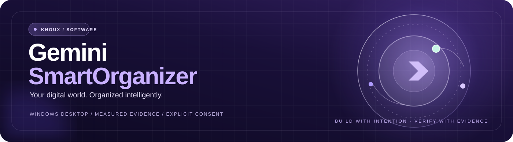
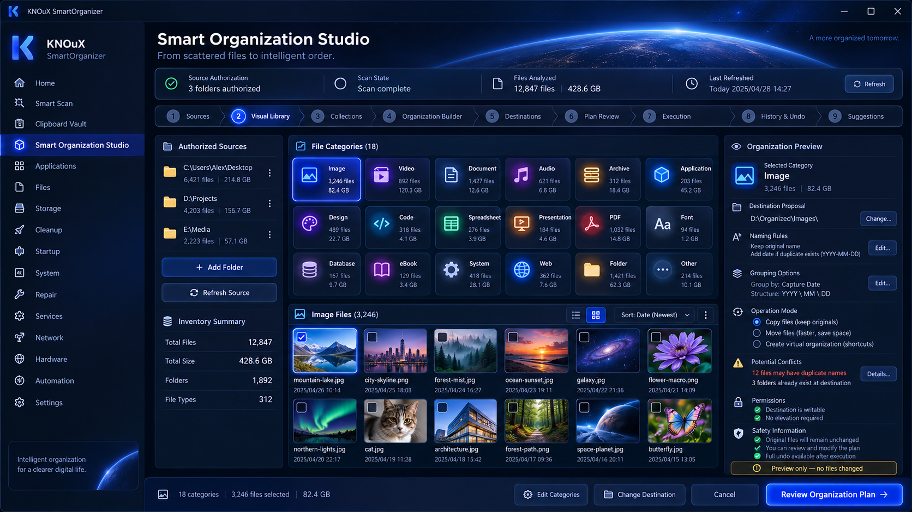
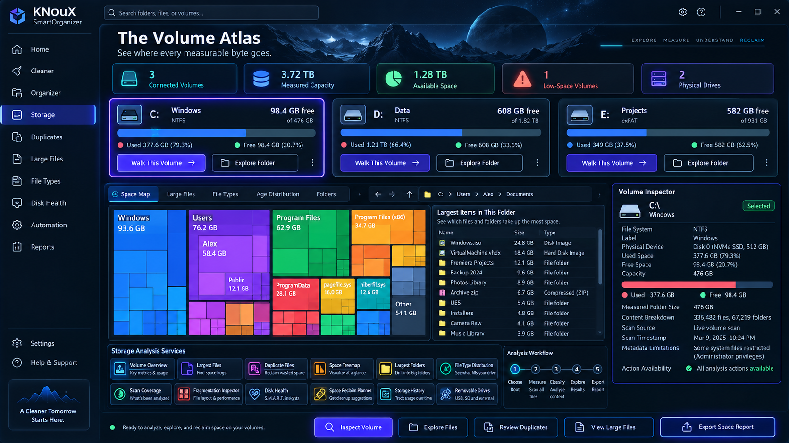
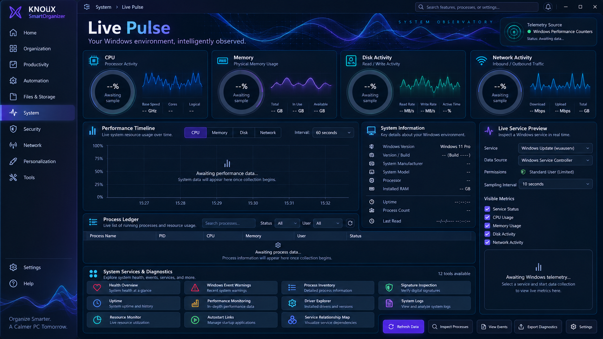
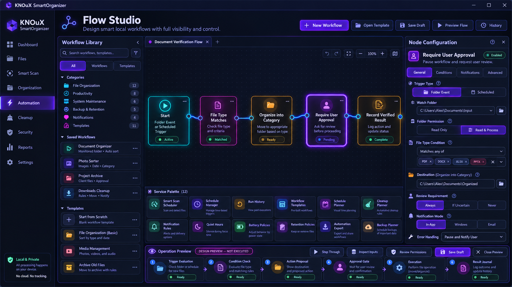
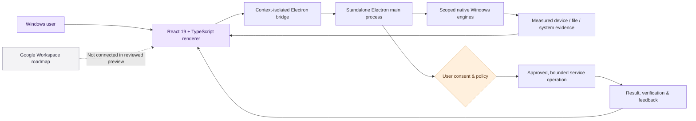

<div align="center">



<br />



<br />

**An independent Windows desktop workspace for understanding, organizing and maintaining your digital environment.**

Measured first. Reviewed by you. Executed only with appropriate permission.

<br />

[](apps/gemini-ui/)
[](apps/gemini-ui/electron/)
[](apps/gemini-ui/package.json)
[](apps/gemini-ui/package.json)
[](#product-maturity--capability-truth)

[](https://github.com/daynightae-cmyk/KNOuX-Gemini-SmartOrganizer/actions/workflows/gemini-platform.yml)
[](https://smart.knoux.store/)

**[Product website](https://smart.knoux.store/)** · **[Explore the source](https://github.com/daynightae-cmyk/KNOuX-Gemini-SmartOrganizer)** · **[Technical roadmap](missions/STANDALONE_AUTONOMOUS_ENTRY.md)** · **[Report an issue](https://github.com/daynightae-cmyk/KNOuX-Gemini-SmartOrganizer/issues)**

<sub>Built by <a href="https://knoux.store/">KNOUX</a> · Founded by Eng. Sadek Elgazar · Windows-first · Explicit-consent engineering</sub>

</div>

---

## The idea

**Your digital world. Organized intelligently.**

KNOuX Gemini SmartOrganizer brings Windows inspection, organization planning and technical evidence together inside a dedicated **React + Electron** application. It is designed to make the state of your files, storage, applications and system easier to understand **before** you take action.

This is a standalone Gemini product—not the retired KNOuX Root renderer, its old Electron launcher, its old CI, or the old Windows installer. The native modules imported for this product live inside the same repository.

> [!IMPORTANT]
> **Development preview, not a claim of full production readiness.** A visible service, a passing test or a read-only workbench does **not** prove that every action has a working executor. Always check the [service evidence](docs/SERVICE_REGISTRY_EVIDENCE.md) and [capability matrix](docs/SERVICE_CAPABILITY_MATRIX.md) for current, per-service status.

### Explore

| | | |
|:---|:---|:---|
| [**Workspace & Home**](docs/HOME_COMMAND_CENTER_AUDIT.md) — measured overview and action entry points | [**Smart Scan**](missions/02_SMART_SCAN_FULLSTACK_MISSION.md) — bounded diagnostics and scan workflows | [**Organization Studio**](missions/03_ORGANIZATION_STUDIO_FULLSTACK_MISSION.md) — file organization planning |
| [**Files**](missions/06_FILES_FULLSTACK_MISSION.md) — inspect, search and classify | [**Storage**](missions/07_STORAGE_FULLSTACK_MISSION.md) — measured volume intelligence | [**Applications**](missions/05_APPLICATIONS_FULLSTACK_MISSION.md) — inventory and software evidence |
| [**Cleanup**](missions/08_CLEANUP_FULLSTACK_MISSION.md) — review candidates, preserve safety | [**Startup & System**](docs/SYSTEM_LIVE_PULSE_AUDIT.md) — operating-system evidence | [**Repair & Services**](docs/REPAIR_RECOVERY_LAB_AUDIT.md) — diagnostics and gated actions |
| [**Automation**](docs/FLOW_STUDIO_AUTOMATION_AUDIT.md) — workflow planning | [**Google Workspace**](docs/GOOGLE_WORKSPACE_CONSENT_AUDIT.md) — consent preview; live OAuth pending | [**Settings & Assistant**](docs/SETTINGS_ASSISTANT_AUDIT.md) — preferences with honest limitations |

## A visual language built for engineering

The project includes **ten approved design references**. These are design-direction images, **not** proof of live functionality or a current production release.

<table>
  <tr>
    <td width="50%" align="center"><br /><b>01 / Smart Organization Studio</b></td>
    <td width="50%" align="center"><br /><b>04 / Storage Volume Atlas</b></td>
  </tr>
  <tr>
    <td width="50%" align="center"><br /><b>07 / System Live Pulse</b></td>
    <td width="50%" align="center"><br /><b>10 / Automation Flow Studio</b></td>
  </tr>
</table>

<details>
<summary><b>Browse all ten approved visual references and historical screenshots</b></summary>

| Design reference | Design reference |
|---|---|
| [01 — Smart Organization Studio](references/REF-01_Smart_Organization_Studio.png) | [02 — Applications & Software Command](references/REF-02_Applications_Software_Command.png) |
| [03 — Files Instant Find](references/REF-03_Files_Instant_Find.png) | [04 — Storage Volume Atlas](references/REF-04_Storage_Volume_Atlas.png) |
| [05 — Cleanup Clean Room](references/REF-05_Cleanup_Clean_Room.png) | [06 — Startup Boot Control](references/REF-06_Startup_Boot_Control.png) |
| [07 — System Live Pulse](references/REF-07_System_Live_Pulse.png) | [08 — Repair Recovery Lab](references/REF-08_Repair_Recovery_Lab.png) |
| [09 — Windows Services Commander](references/REF-09_Windows_Services_Commander.png) | [10 — Automation Flow Studio](references/REF-10_Automation_Flow_Studio.png) |

The repository also preserves [historical UI screenshots](references/historical-gemini-screenshots/). Historical evidence should not be mistaken for verification of the latest commit.

</details>

## Product maturity & capability truth

Current implementation is **iterative and evidence-based**. The real-service program is organized through domain missions and an auditable service registry.

| Area | Current engineering position |
|:---|:---|
| **Electron platform & visual foundation** | Standalone app and native boundary are in source; scoped validation is recorded in the repository. |
| **Home** | Measured, read-only command center; global indexed search and in-place execution remain incomplete. |
| **Studio · Files · Storage** | Measured native foundations and specialized workbenches; distinguish observations from write actions. |
| **Scan · Apps · Cleanup · Startup · System · Repair · Services · Automation** | Scoped implementations and tests exist; **executor completeness varies by service**. |
| **Google Workspace** | Consent review/UI exists; live OAuth PKCE, secure token storage and real Google adapters are **not yet implemented**. |
| **Settings & AI assistant** | Non-secret preferences have persisted flows; secure credential vault, live provider proxy and assistant consent execution are incomplete. |
| **Real-service activation** | Separate workstream for real executors, side effects, postconditions, journals and permission checks. |

**Authoritative, changing evidence:** [Service Capability Matrix](docs/SERVICE_CAPABILITY_MATRIX.md) · [Service Registry Evidence](docs/SERVICE_REGISTRY_EVIDENCE.md) · [Workbench Acceptance](docs/SERVICE_WORKBENCH_ACCEPTANCE.md) · [Mission Entry](missions/STANDALONE_AUTONOMOUS_ENTRY.md)

Do not interpret a dashboard, concept artwork, code presence or CI green status as a guarantee that all services are production-complete.

## Architecture



The principle is simple: **UI → bridge → native capability → bounded result → visible evidence**. Real operations need independent consent and effect verification; they are not established by static UI alone.

### Technology actually used in the repository

| Layer | Technology |
|---|---|
| Desktop shell | Electron 43, Electron Builder |
| UI | React 19, React DOM, TypeScript, Vite 8 |
| Styling and interaction | Tailwind CSS 4, Lucide React, Motion |
| Supporting services | Node.js, Express, dotenv |
| AI SDK dependency | `@google/genai` — installed dependency does **not** prove a live provider session |
| Verification | TypeScript checks, Node-based native tests, Windows GitHub Actions |
| Evidence & plans | Source-controlled missions, service matrices, visual references and migration records |

Versions reflect the checked-in app manifest. No additional dependencies are required merely to render this README.

## Repository map

```text
KNOuX-Gemini-SmartOrganizer/
├── apps/
│   └── gemini-ui/          # Standalone renderer, Electron entry, UI and tests
├── electron/               # Scoped reusable native Windows engines
├── missions/               # Active implementation contracts and task library
├── docs/                   # Capability/evidence matrix and technical audits
│   └── assets/brand/       # Verified KNOUX logo + lightweight README artwork
├── references/             # Approved visual concepts and historical screenshots
├── migration-history/      # Recovery/provenance records; not active app code
├── scripts/
│   └── verify-workspace.py # Fail-closed canonical-workspace preflight
├── .github/workflows/
│   └── gemini-platform.yml # Standalone Windows verification
├── index.html / site.css   # Public information site (not the desktop renderer)
├── AGENTS.md               # Canonical path, branch, safety and agent rules
└── README.md
```

The static site at **[smart.knoux.store](https://smart.knoux.store/)** is an informational development preview, not a hosted substitute for the Windows desktop application.

## Build locally

> [!CAUTION]
> This repository currently enforces a **pinned canonical Windows development workspace and branch**. The preflight intentionally rejects a different checkout. Read [AGENTS.md](AGENTS.md) before editing, running mission scripts or attempting release work. Do not bypass the guard by initializing a different repository.

**Environment used by standalone CI:** Windows + Node.js **22** + npm. Install the project's actual lockfile dependencies and run the verification steps from the authorized checkout.

```powershell
# Canonical workspace (PowerShell)
cd 'D:\KNOUX-Workspace\KNOuX-Gemini-SmartOrganizer'

# Mandatory safety preflight
python scripts/verify-workspace.py

# Reproducible application dependencies
npm run install:app

# Static verification and renderer build
npm run lint
npm run build

# Real, scoped native-contract and desktop smoke tests
npm run test:native
npm run test:studio
npm run test:files
npm run test:storage
npm run desktop:smoke
```

For an authorized desktop development session:

```powershell
npm run desktop:dev --prefix apps/gemini-ui
```

To create **an unpacked local test package**, not a signed release:

```powershell
npm run desktop:pack
```

Additional tests are declared in the root [package.json](package.json), including `test:scan`, `test:apps`, `test:cleanup`, `test:startup`, `test:system`, `test:repair`, `test:services`, `test:automation`, `test:workspace`, `test:settings`, `test:home` and `test:workbench`.

**Builds are not release certification.** Packaging, installed-app smoke checks, code signing, real OS integration and service-specific executor evidence each require their own acceptance.

## Security & privacy commitments

- **Local-first inspection:** observation and measurement are kept separate from destructive changes.
- **No silent mutation:** do not modify personal files, installed applications, registry, startup, services or system settings without the explicit relevant approval.
- **No simulated cloud connection:** Google Workspace is not represented as authenticated in the reviewed development preview.
- **No secret storage shortcuts:** do not place provider tokens or Google credentials in renderer/localStorage as a substitute for a validated native vault.
- **Traceable actions:** real-service work should prove side effects in disposable fixtures, verification/postconditions and recovery wherever feasible.
- **Evidence over claims:** missing information is labelled pending, unavailable or unverified rather than filled with invented results.

Read the project's [Privacy Policy](https://smart.knoux.store/privacy/) and [Terms of Service](https://smart.knoux.store/terms/). Those documents describe the public preview; they do not themselves certify every desktop-service implementation.

## Quality, roadmap & engineering evidence

| Resource | Purpose |
|---|---|
| [Standalone Windows CI](.github/workflows/gemini-platform.yml) | The repository's actual Windows verification workflow |
| [Standalone runtime verification](STANDALONE_RUNTIME_VERIFICATION.md) | Recorded standalone runtime evidence and limits |
| [Migration completeness](MIGRATION_COMPLETENESS_REPORT.md) | Source recovery and original-repository preservation |
| [Service registry](docs/SERVICE_REGISTRY_EVIDENCE.md) | Implemented vs partial vs blocked services |
| [Action-capability matrix](docs/SERVICE_CAPABILITY_MATRIX.md) | Executor, consent, recovery and E2E acceptance requirements |
| [Workbench implementation](missions/15A_INTERACTIVE_SERVICE_WORKBENCHES_MISSION.md) | Interactive tool-specific UI rather than inert service cards |
| [Real-service functionality standard](missions/REAL_SERVICE_FUNCTIONALITY_STANDARD.md) | Explicit effect tests and safe action boundaries |
| [Current task entry](missions/STANDALONE_AUTONOMOUS_ENTRY.md) | Authoritative active priorities and blockers |

<details>
<summary><b>What counts as verified?</b></summary>

- **VERIFIED** — the exact behavior was exercised, with attributable evidence.
- **PARTIAL** — a scoped part works, but the full user-facing contract is not proven.
- **IMPLEMENTED-NOT-VERIFIED** — source exists but runtime evidence is insufficient.
- **BLOCKED** — a specific external dependency, permission or prerequisite prevents acceptance.
- **UNKNOWN** — the available evidence does not establish the claim.

Do not treat `PASS` from a single workflow as a universal product-readiness verdict.

</details>

## Contributing & responsible development

Work from the [documented canonical workspace](AGENTS.md) and preserve unique local development work. The active implementation branch is `feat/gemini-missions`; follow its established review/verification workflow and do not push to retired repositories.

Before proposing a change: inspect source and Git state; avoid competing agent edits; apply a bounded diff; verify targeted tests; review secrets and binary assets; record the exact commit SHA; and obtain separate permission before any potentially destructive live operation.

**Useful links:** [Issues](https://github.com/daynightae-cmyk/KNOuX-Gemini-SmartOrganizer/issues) · [Pull requests](https://github.com/daynightae-cmyk/KNOuX-Gemini-SmartOrganizer/pulls) · [Actions](https://github.com/daynightae-cmyk/KNOuX-Gemini-SmartOrganizer/actions) · [Canonical development guidance](AGENTS.md)

## KNOUX — Corporate identity & contact

<table>
<tr>
<td width="61%" valign="top">

### Built with intention. Verified with evidence.

**KNOUX** is the parent engineering brand behind this project.

**Founder & software engineer:** Eng. Sadek Elgazar · **م. صادق الجزار**

Software engineering, Windows desktop systems, AI automation, full-stack development and product experience.

**[Company website](https://knoux.store/)** · **[Corporate email](mailto:admin@knoux.store)** · **[Call KNOUX](tel:+971503281920)** · **[WhatsApp](https://wa.me/971503281920)**

</td>
<td width="39%" valign="top">

**Connect**

- [KNOUX on GitHub](https://github.com/knoux-io)
- [Engineering GitHub](https://github.com/daynightae-cmyk)
- [KNOUX Facebook](https://www.facebook.com/knouxStore/)
- [Founder Facebook](https://www.facebook.com/CopSadek)
- [KNOUX TikTok](https://www.tiktok.com/@knoux_7)

</td>
</tr>
</table>

<div align="center">

---

**KNOUX · Gemini SmartOrganizer**

*Build thoughtfully. Measure truthfully. Keep the user in control.*

[knoux.store](https://knoux.store/) · [smart.knoux.store](https://smart.knoux.store/) · [admin@knoux.store](mailto:admin@knoux.store)

<sub>© 2026 KNOUX · Developed by Eng. Sadek Elgazar · Source and product capabilities are governed by the repository's actual evidence.</sub>

</div>
